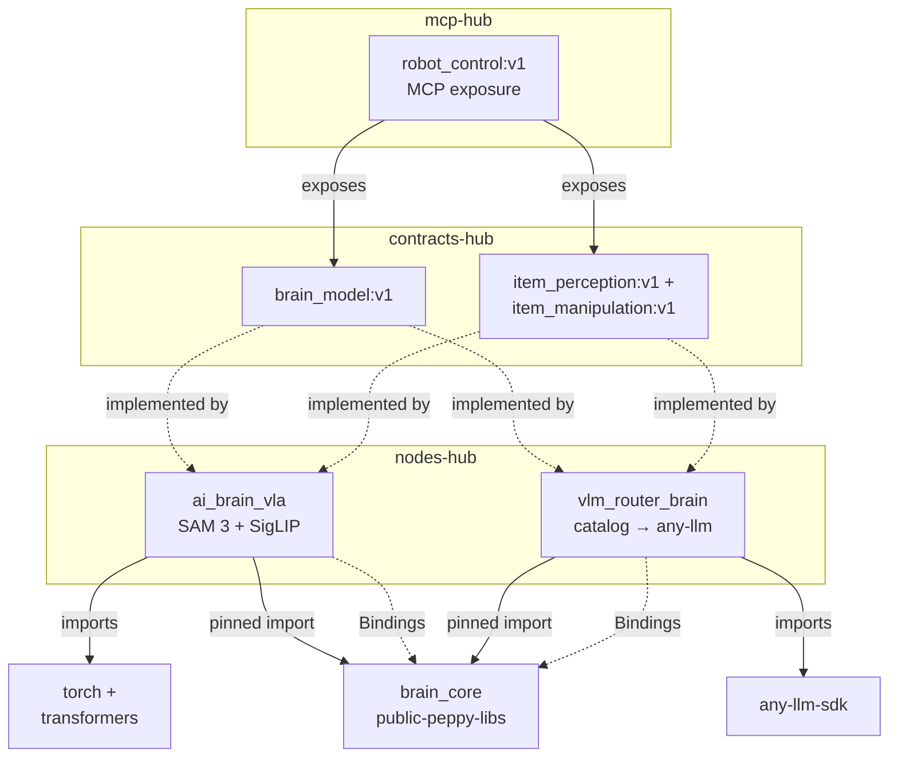
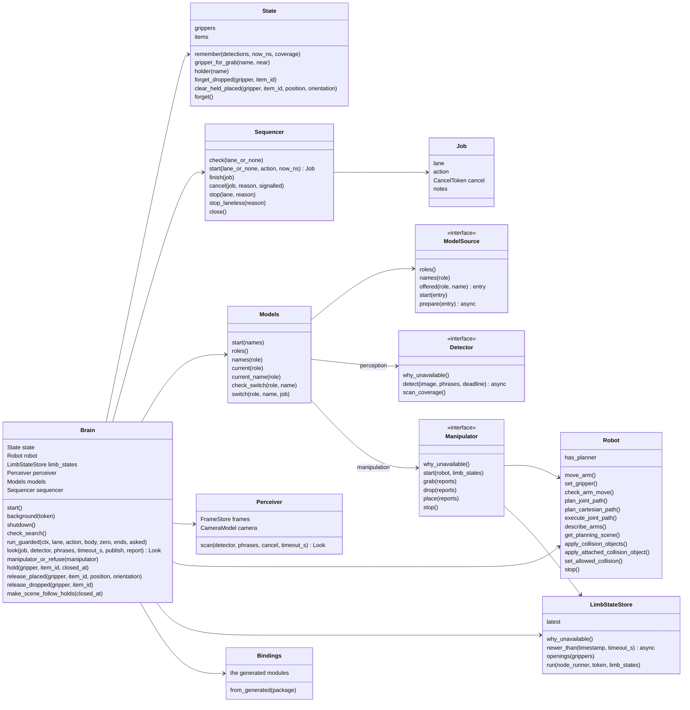
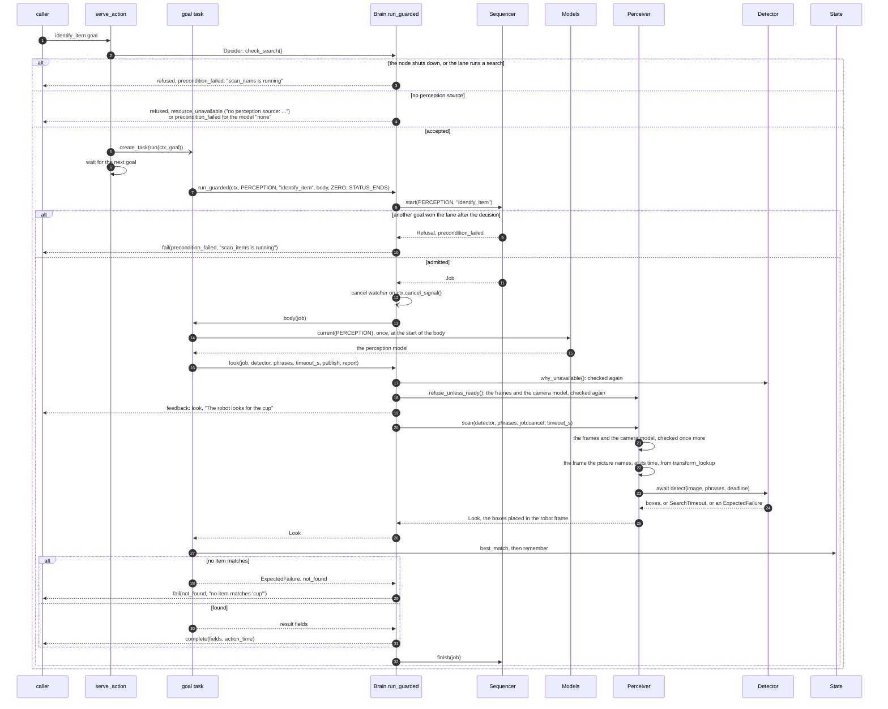
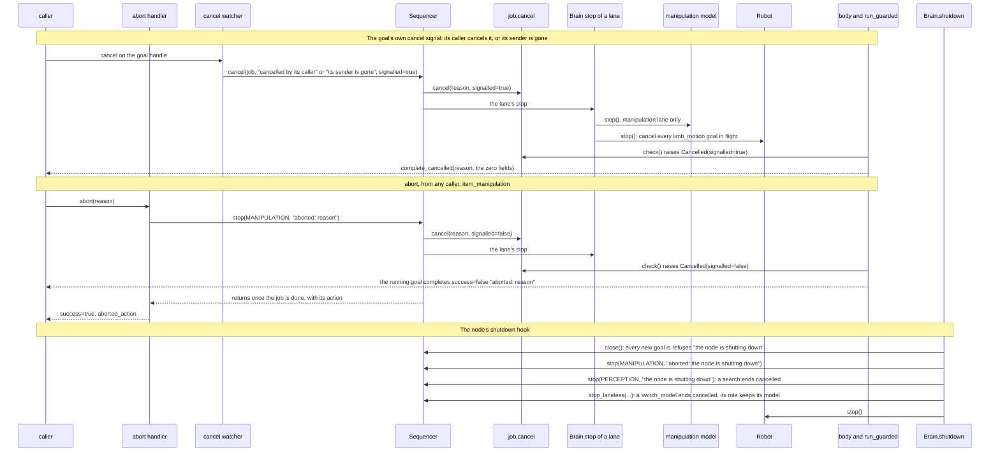

# brain_core

The code every brain node shares. A brain serves `item_perception:v1`,
`item_manipulation:v1` and `brain_model:v1` over a robot that `limb_motion:v1`
drives and `limb_state:v1` measures, and a camera that `rgbd_camera:v1`
streams. brain_core holds the contract rules (item ids, the gripper table, the
lanes, the failure kinds and the result rules), the robot proxy, the camera
frames and geometry, and the loop of each exposed member. A node brings its
generated peppygen modules and its backends, and calls `node.setup`.

Each action with a feedback topic (grab_item, drop_item, place_item,
scan_items and identify_item) publishes one feedback message at the start of
each stage of a goal: the stage, one sentence for the person who looks at
the robot, and the number and the maximum of a stage that repeats (see "The
feedback of a goal" below).

item_perception and brain_model report a refusal or a failure by the status
of the goal: a refused goal and a failed goal carry a failure kind and a
message, and a failed goal gives no result. item_manipulation reports both in
its result, with `success` false and a message, but for the target of a
grab_item or a place_item goal, which the goal's decision refuses: `rejected`
for a target no contract takes, the failure kind of the lookup
(`unknown_frame`, `no_chain`, `extrapolation`, `broken_tree`) for one the
robot's tree cannot place.

The brain holds every place in the robot frame, which `sensor_mounts:v1`'s
describe_sensors names. A picture's points are placed by the frame its header
names, looked up in the robot frame at the picture's capture time through
`transform_lookup:v1`; a picture whose frame the tree does not place is
dropped, and the log gives the lookup's failure kind. A goal's target is
parsed through control_core_py's geometry and placed by its frame, the robot
frame when it names none, at its timestamp in the robot frame at the latest
time, as `item_manipulation:v1` places a target when it accepts a goal. Each
report names the robot frame and the time of what it reports: a scan's and a
search's points the capture time of the picture they come from, a place's
final point the time the backbone measured it. Every move and every request of
the motion planner names the robot frame with no timestamp, the latest time.
So the brain's memory holds while the robot frame stands still on the floor,
as a fixed-base robot's does. Colour and depth are paired by `capture_index`,
and a picture's pixels are its `data`.

Pure Python on numpy, Pillow and control_core_py, whose geometry holds every
rotation the brain makes. brain_core never imports peppygen: peppygen is
generated per node, so the node passes its modules in through `Bindings`.

## Using it

A node depends on brain_core by commit. Both brains pin it in
`[tool.uv.sources]`, the way `so101/backbone` pins its shared libraries:

```toml
[tool.uv.sources]
brain_core = { git = "https://github.com/Peppy-bot/public-peppy-libs", subdirectory = "brain_core", rev = "<commit>" }
```

brain_core depends on control_core_py, the package beside it, by path, so uv
takes control_core_py from the same commit. A node that imports
control_core_py itself lists it among its dependencies with no source of its
own, and gets it from that commit too.

uv fetches a git source with git, and the `peppybot/python-uv-base` image has
no git, so the node's `apptainer.def` installs it in `%post` before
`uv sync`, as nodes-hub's `ai_brain_vla/apptainer.def` does.

Its entry point builds `Bindings` from its peppygen package and hands them to
`brain_core.node.setup` with its `ModelSource`, the models the node can run
for each role. `Bindings.from_generated` finds each module where every
brain's peppygen puts it, so the node's manifest names its slots
`limb_motion`, `limb_state`, `camera`, `geometry`, `sensor_mounts` and
`transform_lookup`, as both brains do. A brain that consumes the motion
planner names its slot `motion_planning` and also consumes limb_motion's
`execute_joint_path`; the modules of a brain that does not are none:

```python
import peppygen
from peppygen import NodeBuilder

from brain_core import node
from brain_core.bindings import Bindings

BINDINGS = Bindings.from_generated(peppygen)


async def setup(params, node_runner):
    return await node.setup(params, node_runner, BINDINGS, MyModels(params))


def main() -> None:
    node.configure_logging("my_brain")
    NodeBuilder().run(setup)
```

The parameters the core reads are `limbs`, `camera_name`, the name the
camera runs under, which each search's result names, `lookup_timeout_s`, how
long a lookup in the robot's tree waits for the transforms of its time, and
the starting model of each role, `perception_model` and
`manipulation_model`.

## The parts

| Module | What it holds |
|---|---|
| `ports` | The plain data that crosses the seams (`Box`, `Detection`, `Item`, `ItemShape`, `TargetItem`, the item a place or a drop puts the held item in or on, `Gripper`, `Outcome`, `Pose`, and `Senses`, what a manipulator is started with: the robot, the limbs, the chest perceiver, the wrist frames and the place of the frame a picture names at its capture time), the roles a model serves (`Role`, `parse_role`), the failure kinds a goal ends with (`FailureKind`), `Refusal` and `ExpectedFailure`, each with its kind, `Cancelled`, `CancelToken`, `Deadline`, `SearchTimeout`, the port a detector implements, `Detector` (an awaited `detect`, `why_unavailable`, and `starting`, the part of it that ends on its own while the detector starts), and the port a node implements, `ModelSource` |
| `words` | The one rule for whether a description names a label |
| `stages` | The feedback of a goal: the `Stage` of each action, the `Report` (the stage, its sentence, its number and maximum), `reporter_of`, the `Reporter` of a goal context, and the one place that writes every sentence: `scan_look` and `identify_look` for a search, `GrabReports` and `CarryReports`, the reports of a manipulation goal bound to the labels of its items, which a manipulator and its aligner (`AlignReports`) call by stage |
| `limbs` | The `limbs` parameter parsed: each gripper with the arm that carries it |
| `state` | The grippers, the known items and their ids, the rules that resolve a goal's names, `target_item`, the target value of a place or a drop or its refusal, and `forget`, which drops every item and every hold for a world that changed while the brain did not look (forget of brain_model) |
| `sequencer` | One sequence at a time per lane (a lane is a `Role`), lane-less jobs beside them, and the way to stop the ones that run |
| `robot` | The proxy to the backbone and to the motion planner: one limb_motion goal per move, how each one ended (completed, cancelled with its reason, refused or failed with its kind, or lost), `check_arm_move`, which asks whether a move has a plan and moves nothing, `stop`, which cancels every move in flight, `has_planner`, whether the brain consumes the motion planner and its slot is bound, `plan_joint_path` and `plan_cartesian_path`, each a goal in flight like a move that a stop cancels and that moves nothing, `execute_joint_path`, which runs a plan from its start, and the planner's `describe_arms`, `get_planning_scene` and three scene writes (`apply_collision_objects`, `apply_attached_collision_object`, `set_allowed_collision`), service calls like `check_arm_move` that say why when they give no answer; every command in the robot frame at the latest time |
| `limb_state` | The robot's measured limbs: each limb_states message parsed into a `LimbSnapshot` (each arm's joints and grasp pose, each gripper's opening), the latest one kept, the wait for one captured after another, and the openings get_state reports |
| `models` | The model of each role, and the switch rule: a goal uses only its own role's model, and a switch never changes the model of a goal that runs |
| `brain` | The parts assembled, `Decider`, where a goal is refused before it is accepted and the goal its handler runs is made from its request, `place_target`, a goal's target parsed and placed in the robot frame, `run_guarded`, where every goal is admitted, ended the way its contract asks and logged, `hold`, `release_placed` and `release_dropped`, each the held flag of a result and then the scene, and `make_scene_follow_holds`, which makes the motion planner's scene equal to the held flags, after each of those and at the start of each grab and each place: each held item's object `brain/<item_id>` attached to its arm's grasp link, and no other object of the brain |
| `handlers` | One module per exposed member |
| `serve`, `waiting` | The loop of an exposed action or service, and the one way a part waits unless a stop comes first |
| `perception` | The `Perceiver` (frames in, world detections out, each with its shape for the motion planner, which the look's log line names), `item_points` (the depth readings inside a box, less the surface under the item, the group that holds the reading nearest the box's centre) and `item_box` (the upright box around them, turned to the smallest rectangle from above, from the surface to the highest point: an `ItemShape`), the frame store, the camera model, the intrinsics learner and the `Placer` (the robot frame from sensor_mounts; the frame a picture names at its capture time, and a goal's target at its timestamp, placed in it by transform_lookup), `in_daemon_thread` for a detector whose model blocks, `NoneDetector`; `wrist`, the newest frame of each arm's wrist camera, the wait for one captured after a move, and the period of each camera as its frames arrive |
| `manipulators` | The `Manipulator` port (started with the `Senses`; `grab`, `drop`, `place`, each given the reports of its goal, `stop`, `why_unavailable` and `starting`); `none`, the `NoneManipulator`; `scripted`, the `ScriptedManipulator`, a grab from above through a fixed sequence of moves, with the `CentreProposer`, the grasp from the item's position, the geometry (`grasp`: the orientations workspace_core tries, the pre-grasp and lifted points, the turn about the vertical, `Grasp` and the `GraspProposer` port) and the `Aligner` port (`aligning`) of the step a node may put between the move above the item and the descent, given the reports of the goal |
| `bindings`, `node` | The generated modules a node passes in, and the shared entry |

## Tests

```
uv sync --frozen && uv run --frozen pytest
```

The tests run every core rule against fakes of the generated modules
(`tests/fake_peppygen.py`): no peppygen, no router, no robot and no model.
The fake goal context (`tests/conftest.py`, `FakeCtx`) checks each feedback
message against the feedback fields and the stages of its action.

## How it works

### Where it sits

Both brains are thin: each brings only its models, and brain_core holds the
shared work. A dotted arrow is a manifest relation or a hand-over at run time.



brain_core receives each node's `Bindings` and its `ModelSource`; the
catalog and any-llm stay inside the router, and torch inside ai_brain_vla.

### Structure



A node implements `ModelSource`, and its models implement `Detector` or
`Manipulator`. `NoneDetector` and `NoneManipulator` are the models of a role
with none; `ScriptedManipulator` is a manipulator any node can offer, built
on a `GraspProposer`, as it is or with an `Aligner` of the node's own.

### A goal, from its arrival to its result

`identify_item`; `scan_items` runs the same way, and `switch_model` is
decided by its role and model (`Models.check_switch`). The manipulation
goals accept every goal whose target, where they read one, the robot's tree
places, run in the manipulation lane on the manipulation model, and report
every other refusal and a failure in their result.



A Refusal or an ExpectedFailure raised in the body goes up to
`run_guarded`, which ends the goal through the `Ends` of its contract:
`STATUS_ENDS` fails the goal with the kind and the message and gives no
result, `RESULT_ENDS` completes it with success false and the message. A
search past its bound fails with `timeout`, and any other exception with
`attempt_failed`. `action_time` is the elapsed time whatever the outcome.

### The feedback of a goal

grab_item, drop_item and place_item of item_manipulation, and scan_items
and identify_item of item_perception, publish one feedback message at the
start of each stage of a goal (`stages.Report`): `stage`, `activity`, the
sentence, which has the mark `activity` that the workflow director reads,
and `number` and `maximum`. A stage that repeats, a question to the
aligning model or a correction it gives, has its number from 1 and how many
times it can repeat in the goal, and its sentence ends with " (N of M)", so
the sentence alone tells one repeat from the next. Any other stage has 0
and 0. No sentence ends with a full stop.

Each sentence is for a person who looks at the robot and is not technical:
it names the robot, its arm, its hand and each item by its label, in lower
case with an underscore as a space and its first article replaced by "the"
(a model can label an item "the cup") (`stages.the_item`), and "the item"
for an item with no label, such as one a goal addressed by pose. It names no
link, joint, contract or model, and no term of the motion planner.

| Goal | Stage | Sentence, for an apple and a bowl |
|---|---|---|
| grab_item | `plan` | The robot opens its hand for the apple and finds a way to reach it |
| | `move_above` | The robot moves its hand above the apple |
| | `align_look` | The robot looks at the apple and decides how to correct its hand (2 of 5) |
| | `align_move` | The robot corrects the position of its hand above the apple (2 of 5) |
| | `grasp` | The robot lowers its hand, closes it on the apple and lifts it |
| place_item into the bowl | `plan` | The robot finds a way to carry the apple above the bowl |
| | `move_above` | The robot carries the apple above the bowl |
| | `align_look` | The robot looks at the bowl and decides where to put the apple (1 of 2) |
| | `align_move` | The robot corrects the position of the apple above the bowl (1 of 2) |
| | `set_down` | The robot lowers the apple into the bowl, opens its hand and moves its arm back up |
| place_item at a pose | `plan` | The robot finds a way to carry the apple above the spot where it puts it down |
| | `move_above` | The robot carries the apple above the spot where it puts it down |
| | `align_look` | The robot looks down and decides where to put the apple (1 of 2) |
| | `align_move` | The robot corrects the position of the apple above the spot where it puts it down (1 of 2) |
| | `set_down` | The robot puts the apple down, opens its hand and moves its arm back up |
| drop_item above the bowl | `plan`, `move_above`, `align_look`, `align_move` | As place_item into the bowl |
| | `release` | The robot opens its hand and lets the apple fall into the bowl |
| drop_item with no target item, or with jaws closed on air | `release` | The robot opens its hand and lets go of the apple |
| scan_items | `look` | The robot looks for each item that it can see |
| identify_item, "a red cup" | `look` | The robot looks for the red cup |
| identify_item, "" | `look` | The robot looks for an item that it can take |

A search publishes `look` in `Brain.look`, once the detector, the frames and
the camera model can serve it, before the detector looks; identify_item
replaces the first article of its description with "the". A manipulation
handler makes the reports of its goal once the rules of its names passed
(`GrabReports` with the label of the item, `CarryReports` with the label of
the held item, from `State.label_of`, and the target item), and hands them
to the manipulator, which publishes each stage as it starts and hands them
to its aligner. The scripted manipulator publishes, for a grab, `plan`
before the jaws open for the item, `move_above` once an orientation
reaches and before the transit runs, and `grasp` before the descent; for a
place, `plan` once its checks before any move passed, `move_above` as a
grab's, and `set_down` before the line down; for a drop above a target
item, `plan` and `move_above` as a place's, then `release` before the jaws
open; for any other drop, and a drop whose jaws stand closed on air,
`release` alone. The second path of a grab's transit stays in `plan` (the
close of the jaws, the plans with the hand closed) and in `move_above` (the
run of the plan, the open at the pre-grasp point). An aligner publishes
`align_look` at the start of each question to its model and `align_move`
before each correction that it moves, with the number of the step and the
steps of its alignment.

A goal refused before its first stage publishes nothing: a refusal of its
decision, a refusal of its names or its source when it starts, and a
sequence that the manipulator ends before its first stage, such as a place
whose jaws stand closed on air. abort, get_state, forget and switch_model
publish nothing. A report that the goal context cannot publish is logged,
and the goal goes on, and so is a step of an aligner whose number is not
from 1 to the steps of its alignment: what the robot does never depends on
its feedback.

### A scripted grab

`ScriptedManipulator.grab`, after the handler has resolved the item and the
gripper. Each step that fails ends the grab with the backbone's own words. A
step that fails once the descent was sent first retreats: the gripper opens
and the arm moves straight back up to the pre-grasp point. A step that fails
after the jaws opened and before the descent puts the jaws back to the
opening that the latest limb_states snapshot gave before the grab, and the
arm stays where it is. Once the arm moved toward the item, the put back
does not open the jaws wider there: it closes them to that opening when it
is narrower than the opening of the latest snapshot, and the jaws stay as
they stand otherwise. A goal that a stop ended, a goal that ends cancelled,
retreats from nothing and puts nothing back; a put back that a stop ended
ends the grab as a stop.

With an `aligner`, one more step sits between the move to the pre-grasp
point and the descent. The manipulator hands it the item, the gripper, the
pre-grasp, grasp and lifted points and the orientation (`AlignRequest`, in
`manipulators/scripted/aligning`), and the aligner, a node's own behind the
`Aligner` port (vlm_router_brain's `ModelAligner`, a model that looks through
the wrist and chest cameras), may move the gripper sideways and turn it at
the same height through the manipulator's `refusal_for` (whether the
backbone has a plan for points at an orientation) and `move_to`, so each of
its moves carries the bars of every arm move. It ends `Aligned` with the
points the grab goes on with, `GaveUp`, `OutOfSteps` or `Stopped` when a
stop ended a move; the last three fail the grab there, before the descent.
A place runs the same step above the spot the held item goes to, measured
from the target point, and then lowers the item on a line down that stops
on contact: the place opens where the line down ended, on contact or at the
target.

Every move names its bars, as the limb_motion contract has the caller do. An
arm move, the retreat's and a place's too, plans within 1 mm and 0.01 rad of
its pose and settles within `settle_position_m` (2 cm) and
`settle_orientation_rad` (0.15 rad), the settle the robots' endpoint gives for
the OpenArm v2, or fails with `timeout` `settle_timeout_s` (2 s) after
its planned end, with the backbone's words, such as `still 8.0 mm / 0.02 rad
from the target, 2.0 s after the planned end`. Every arm move names the
contract's `contact_gap_m` as 0, no contact check, and the fastest duration,
but a line down, the descent of a grab and the line down of a place: it
names `line_down_contact_gap_m` (2 cm, the settle position tolerance, so no
arm stands between a settle and a contact), and its duration is its length
divided by `line_down_speed_m_s` (5 cm/s): 1.5 s for the 7.5 cm of a grab's
descent, 3 s for the 15 cm from the high pre-place point. A grab whose
descent ends on contact closes there, where the fingers met the item or what
is under it. A check asks with the same
pose and duration. A gripper move waits up to `grip_settle_timeout_s` (2 s) for the
jaws to stand still.

```mermaid
sequenceDiagram
    participant H as grab_item handler
    participant SM as ScriptedManipulator
    participant P as GraspProposer
    participant R as Robot
    participant L as LimbStateStore
    H->>SM: grab(item, gripper, max_effort, cancel, reports)
    SM->>P: propose(item)
    P-->>SM: Grasp: the point, the orientations to try
    Note over SM: feedback: plan
    SM->>R: set_gripper(g, the item's width and 1.5 cm each side, else 1)
    loop each orientation, until one plans
        SM->>R: check_arm_move: pre-grasp, grasp, lifted points
    end
    Note over SM: none plans: "no plan reaches item 'x' with gripper 'g': <last refusal>", the jaws go back to their opening before the grab
    Note over SM: feedback: move_above
    SM->>R: move_arm(pre-grasp): settles, or fails
    Note over SM: feedback: grasp
    SM->>R: move_arm(grasp point), a line down: settles or ends on contact, or fails
    SM->>R: set_gripper(g, 0, max_effort)
    Note over SM: final_opening below hold_opening_min: "gripper 'g' closed on nothing"
    SM->>R: move_arm(lifted point)
    SM->>L: newer_than(the latest stamp at the lift's result, snapshot_wait_s)
    Note over SM: none: "no limb_states snapshot after the lift"<br/>opening below hold_opening_min, or more than hold_drop_max below the close's: "item 'x' slipped while lifting"
    alt a step from the descent on failed, and no stop ended it
        SM->>R: set_gripper(g, 1), move_arm(pre-grasp)
        Note over SM: either fails: "<failure>; the retreat to the pre-grasp point failed: <why>"
        SM-->>H: Outcome(false, the failure)
    else every step went through
        SM-->>H: Outcome(true, where the jaws closed): the handler holds through Brain.hold
    end
```

Before the checks the jaws open only as wide as the item and 1.5 cm on each
side (`approach_margin_m`), as a fraction of their 14.8 cm span
(`jaw_travel_m`, the OpenArm v2's in Waldo), so the fingers come down beside
the item and not on what stands next to it. The width is the one the look that
last saw the item measured: the box's left and right edges at the depth of its
seen point. An item of no known width, one addressed by pose or put down by
place_item, gets the jaws fully open. A grab that no orientation reaches puts
the jaws back to their opening before the grab, as each step that fails before
the arm moves does, so the next grab starts as this one started. A put back
that fails adds why to the failure: `<failure>; putting the jaws back to 0.00
failed: <why>`.

With the motion planner bound (`Robot.has_planner`), the transit to the
pre-grasp point is planned, and `ScriptedManipulator._transit` is the one
step that asks. For each orientation, a `plan_joint_path` brings the grasp
link to the pre-grasp point (within 1 mm and 0.01 rad, `rrt_connect`, no
refiner, in `allowed_planning_time_s`, 0.5 s), and a `plan_cartesian_path`
with no collision check, from the end of that plan through the grasp and
lifted points, tests the reach of the descent and the lift. The first
orientation that passes both runs its plan with `execute_joint_path`, the
plan's start as the expected start, each joint within 0.05 rad at the end,
with `contact_gap_m` 0, no contact check, as every arm move but a line down.
A grab whose orientations all fail, and that does not take the second path
below, ends before the arm moves, with the last one's words, the planner's
kind first (`no_path: ...`): no line takes the place of a plan.

The grab plans with the jaws open as it opened them, so the planner examines
the open hand for the full transit and the grab takes an orientation whose
open fingers are clear before the arm moves. On a gripper whose fingers turn
on pivots, a finger moves down when the jaws open, so open jaws can bring a
part of the hand nearer to a thing below it than the clearance of the
planner. The grab takes a second path only when the planner refuses the
start (`start_in_collision`). The start is where the arm stands, the same
for each orientation, so the first refusal ends the search:

1. The jaws close. A grab takes a gripper that holds nothing, so the close
   is safe, also when a place left the jaws open.
2. Each orientation is planned again with the hand closed. When the planner
   refuses the start again, or no orientation plans, the grab fails before
   the arm moves, with the planner's words: `the planner refuses the start
   where the arm stands with the jaws open, and with the jaws closed no plan
   reaches item ...`.
3. The plan runs to the pre-grasp point, and the jaws open there for the
   item.
4. The grab asks the planner whether the arm is clear where it stands, the
   open jaws included, with the request of the checked descent below: its
   start is where the arm stands, and the planner refuses a start in
   collision as it refuses that of a plan. A path in the answer lets the
   grab go on as on the first path, and with no aligner the log of the
   checked descent reads that answer. Any other answer fails the grab with
   the planner's words, the arm stays at the pre-grasp point, and the grab
   tries no other orientation: a start in collision gives `the planner does
   not find the arm clear at the pre-grasp point ... with the jaws of
   gripper 'g' open: <words>`, and any other answer `the planner cannot
   tell whether the arm is clear at the pre-grasp point ...`, since the plan
   examined the closed hand alone.

A brain without the planner has the first path alone: check_arm_move gives
no kind for a refusal. A place holds its item, so its jaws stay closed and
it has no second path. The descent, the lift and the retreat stay `move_arm`
lines. The log line counts the plans and the reach tests, and
each planned transit that ran logs a line of its own. Before it plans, the
grab adds the item's object, `brain/<item_id>`, to the planning scene at the
item's place (the box its look measured, or a 5 cm sphere at its position
for an item no look measured) and lets the gripper's links touch it: the add
clears the item's cubes from the planner's map, so none stay under the hand
after the lift. Each way the grab fails or stops removes the object, after
the retreat when there is one and before the put back of the jaws; a grab
that holds leaves it, and the brain
moves it to the hand and attaches it (`Brain.hold`). Just before the descent,
after the aligner, the grab asks the planner what a checked descent would
answer: a `plan_cartesian_path` with the collision check from where the arm
stands through the grasp and lifted points. It logs the share of the lines
that path covers (`checked descent of item ...`) and descends by its lines
whatever the answer.

Each place logs one line before its line down: a pre-place point lower than
the first, the orientation that planned with the calls it took, and the
aligner's correction. Each grab logs one line: the orientation that planned, with the number and
the total time of the check_arm_move calls; how wide the jaws opened for the
item's width; the second path, with the planner's words for the start it
refused with the jaws open; where the descent's result put the
grasp point against the commanded one (`[dx, dy, dz] cm`), measured once the
arm settled or ended on contact, and `on contact` when it did; limb_state's
grasp point at the close; the two openings it judged; and the retreat or
the put back of the jaws.

A place whose jaws stand closed on air (an opening below `hold_opening_min`
in the latest snapshot: the item slipped since the grab) fails before any
move and says so; a drop lets the brain forget the item. Otherwise a place
carries the item to the pose through its pre-place point,
`clearance_m` and `held_item_depth_m` (7.5 cm, how far a held item may
reach below the grasp point) above the pose, so the item clears the floor of
a container and what already stands in it until the descent, or `clearance_m`
alone above it where the backbone has no plan that high. The line down runs
from the pre-place point to the pose and stops on contact, so the arm does
not press the item on what it is set on. The reach test of the line down and
the aligner's checks use the pose. With the motion planner bound, the
transit to the pre-place point is planned as a grab's is: each orientation
planned to the high pre-place point with the reach of the line down tested
from the end of the plan, then each to the low one; only a place that no
orientation reaches at the high point tries the low one. When the line down
completes, settled at the pose or on contact, the item resting on what is
under it (the rim or the floor of a container, or the items already in it,
off whose round tops an item slides a few centimetres before it rests), the
place opens where the arm stopped, reports that point and climbs back to the
pre-place point; a contact is logged with where the arm stopped against the
pose. A line down that fails, with `timeout` or another kind, or that a stop
ended, fails the place with the jaws closed: the gripper still holds the
item. A climb that fails is logged and the place still succeeds, since the
item is down and the jaws are open.

A place or a drop can name a target item, the item to put the held item in
or on (`target_item_id` of item_manipulation): the handler asks
`State.target_item`, which refuses an unknown id, the held item itself and
an item that another gripper holds, all before any move, and builds the
`TargetItem` from what the brain knew of the item: the centre and the shorter
side of its box, its top and its bottom (the surface under it), or, with no
box, its seen point, its measured top and its width. A box whose longer side
is under half the item's width across the picture is fitted around
something that lies in the item, such as a fruit in a bowl: x and y then
come from the seen point and the width from `width_m`. A place into a target
carries the held item from above, at each roll, to 12.5 cm over the target's
top (`above_target_m`), else 7.5 cm, with the line down to the target's bottom
in its reach test; with an aligner, the model corrects the held item's place
above the target, told its label and width (`AlignRequest.into`); the line
down from there to the target's bottom stops on contact, so the item rests on
the target's floor or on what it holds, and the jaws open where the arm
stopped, then the arm climbs back. The goal's `target` is not read. A drop
above a target makes the scene follow the holds, carries the same way with the
pre-place point alone in its reach test, aligns with no descent after it
(`AlignRequest.descends` false), and opens there, with no climb; the brain
forgets the dropped item. The target keeps its id and what the brain knew of
it.

A look that names a known item with a box matches it when its box centre, or
its seen point when it has no box, lies inside the footprint of that box:
the seen point of a bowl rises to the top of each fruit put in it and moves
aside with them, while the bowl stays. A new box inside that footprint
leaves the known box, its top raised to the higher of the two, since the
depth step fits a filled bowl's box around a fruit in it.

A place and a grab carry the arm to their pre point on the carry step of
`ScriptedManipulator`: the transit at each height in turn until an
orientation reaches, then the move there. It measures the check_arm_move
calls, the plans and the reach tests it ran, their time, and the height of
the pre point above the grasp point or the pose. With an aligner, a place
and a grab then run its align step, which records the aligner's ending,
the steps the model took, how far the grasp point moved and the line the
jaws close along. A place reads as its four steps: carry, align, descend
and release. The line down of a place and of a grab runs on its descend
step, which goes through when the line down completes,
settled or on contact, and measures how far short of its end it stopped.
A drop and the release of a place run on its release step, which opens the
gripper and, for a place, climbs back; a drop above a target runs carry,
align and release. A step returns its `StepRecord`: its name, what it was asked, its
result, its `StepFailure` (`no_reach`, `plan`, `move`, `alignment` or `stopped`)
with the words, and its measured numbers, the unit in each name. The
sequence keeps the records in order and stops at the first one with a
failure, whose words end the outcome, and the outcome keeps the records in
`Outcome.steps`, which no comparison of two outcomes reads.

`CentreProposer` lowers a seen item's position by `grasp_depth_m` and tries
the eight rolls of a grasp from above. Under the centre of the box of an open
item, a mug or a bowl seen from above, the camera sees the inside bottom, so
when the top that the look measured for the item (`top_z`: the 90 % quantile
of the heights that the depth readings of the middle 60 % of its box give)
stands from `open_item_depth_m` (3 cm) to `open_item_max_depth_m` (12 cm)
above the seen point, the proposer lowers the point over the seen point at the
height of the top instead, and the jaws close on the walls. A top that stands
higher is that of a taller thing that a loose box takes in, so the proposer
lowers the seen point. An item whose position is a grasp point
(a grab by pose, or an item place_item put down) is grasped there unlowered,
in its own orientation alone when it has one. After every await the sequence
checks its cancel token, so a cancel, an abort or a shutdown ends it at the
next step.

### Cancel, abort and shutdown


