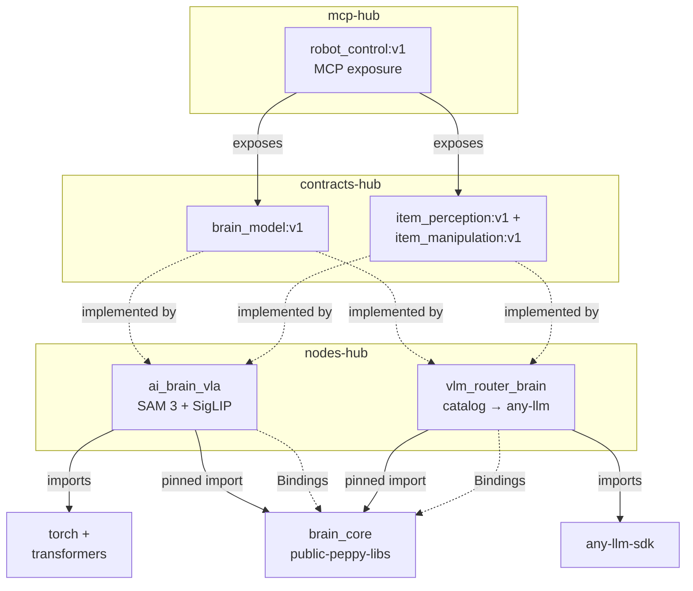
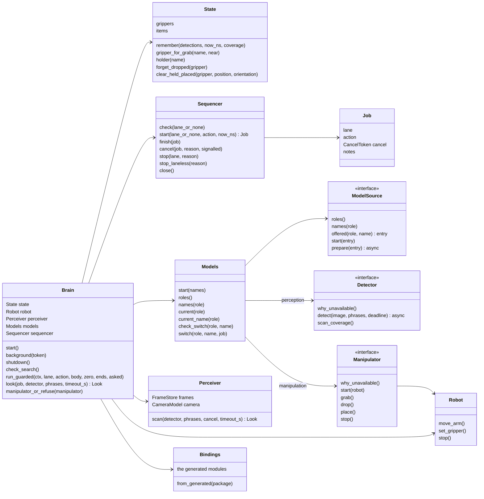
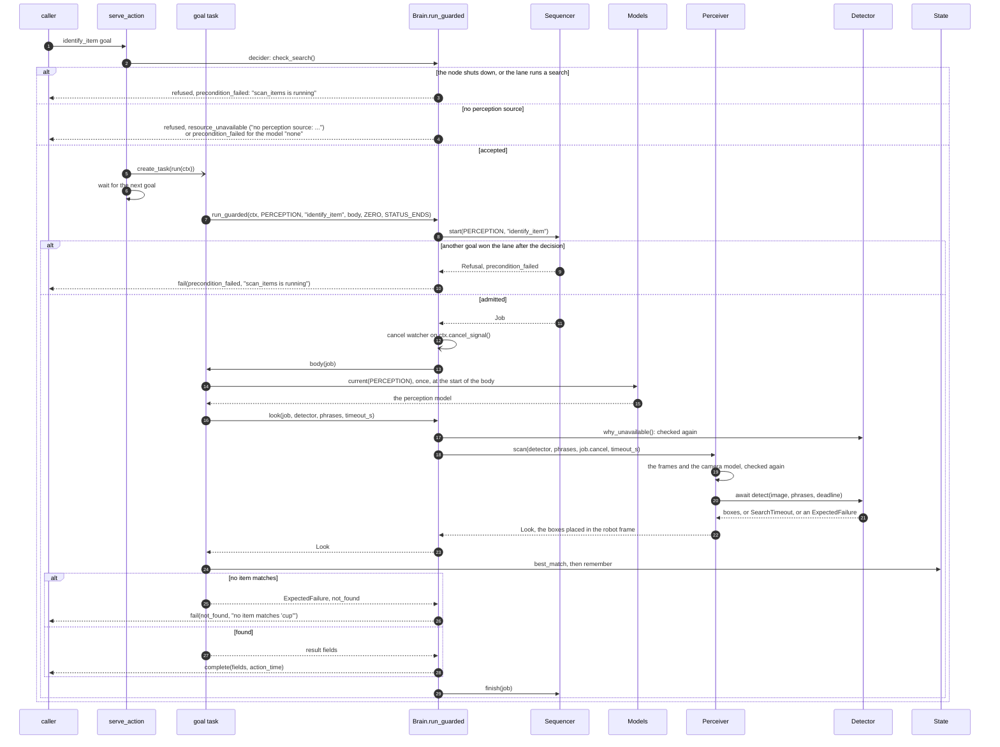
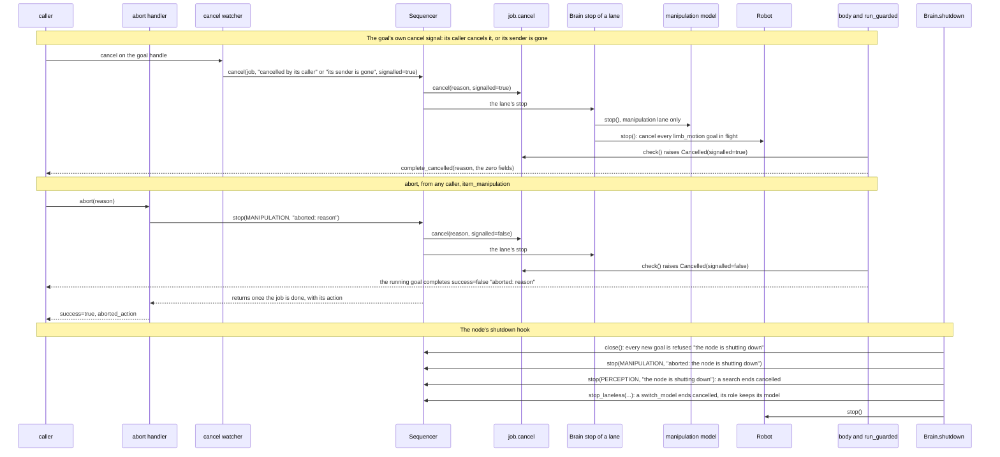

# brain_core

The code every brain node shares. A brain serves `item_perception:v1`,
`item_manipulation:v1` and `brain_model:v1` over a robot that `limb_motion:v1`
drives and a camera that `rgbd_camera:v1` streams. brain_core holds the contract rules (item ids,
the gripper table, the lanes, the failure kinds and the result rules), the
robot proxy, the camera frames and geometry, and the loop of each exposed
member. A node brings its generated peppygen modules and its backends, and
calls `node.setup`.

item_perception and brain_model report a refusal or a failure by the status
of the goal: a refused goal and a failed goal carry a failure kind and a
message, and a failed goal gives no result. item_manipulation reports both in
its result, with `success` false and a message.

Pure Python on numpy and Pillow. brain_core never imports peppygen: peppygen is
generated per node, so the node passes its modules in through `Bindings`.

## Using it

A node depends on brain_core by commit. Both brains pin it in
`[tool.uv.sources]`, the way `so101/backbone` pins its shared libraries:

```toml
[tool.uv.sources]
brain_core = { git = "https://github.com/Peppy-bot/public-peppy-libs", subdirectory = "brain_core", rev = "<commit>" }
```

uv fetches a git source with git, and the `peppybot/python-uv-base` image has
no git, so the node's `apptainer.def` installs it in `%post` before
`uv sync`, as nodes-hub's `ai_brain_vla/apptainer.def` does.

Its entry point builds `Bindings` from its peppygen package and hands them to
`brain_core.node.setup` with its `ModelSource`, the models the node can run
for each role. `Bindings.from_generated` finds each module where every
brain's peppygen puts it, so the node's manifest names its slots
`limb_motion`, `camera`, `geometry` and `camera_mounts`, as both brains do:

```python
import peppygen
from peppygen import NodeBuilder

from brain_core import node
from brain_core.bindings import Bindings

BINDINGS = Bindings.from_generated(peppygen)


async def setup(params, node_runner):
    return await node.setup(params, node_runner, BINDINGS, MyModels(params))


def main() -> None:
    node.configure_logging("my_brain")
    NodeBuilder().run(setup)
```

The parameters the core reads are `limbs`, `camera_name`, and the starting
model of each role, `perception_model` and `manipulation_model`.

## The parts

| Module | What it holds |
|---|---|
| `ports` | The plain data that crosses the seams (`Box`, `Detection`, `Item`, `Gripper`, `Outcome`, `Pose`), the roles a model serves (`Role`, `parse_role`), the failure kinds a goal ends with (`FailureKind`), `Refusal` and `ExpectedFailure`, each with its kind, `Cancelled`, `CancelToken`, `Deadline`, `SearchTimeout`, the two ports a backend implements, `Detector` (an awaited `detect`, and `why_unavailable`) and `Manipulator`, and the port a node implements, `ModelSource` |
| `words` | The one rule for whether a description names a label |
| `limbs` | The `limbs` parameter parsed: each gripper with the arm that carries it |
| `state` | The grippers, the known items and their ids, and the rules that resolve a goal's names |
| `sequencer` | One sequence at a time per lane (a lane is a `Role`), lane-less jobs beside them, and the way to stop the ones that run |
| `robot` | The proxy to the backbone: one limb_motion goal per move, how each one ended (completed, cancelled with its reason, refused or failed with its kind, or lost), and `stop`, which cancels every move in flight |
| `models` | The model of each role, and the switch rule: a goal uses only its own role's model, and a switch never changes the model of a goal that runs |
| `brain` | The parts assembled, `decider`, where a goal is refused before it is accepted, and `run_guarded`, where every goal is admitted, ended the way its contract asks and logged |
| `handlers` | One module per exposed member |
| `serve`, `waiting` | The loop of an exposed action or service, and the one way a part waits unless a stop comes first |
| `perception` | The `Perceiver` (frames in, world detections out), the frame store, the camera model and the geometry learners, `in_daemon_thread` for a detector whose model blocks, and `NoneDetector` |
| `manipulation` | `NoneManipulator` |
| `bindings`, `node` | The generated modules a node passes in, and the shared entry |

## Tests

```
uv sync --frozen && uv run --frozen pytest
```

The tests run every core rule against fakes of the generated modules
(`tests/fake_peppygen.py`): no peppygen, no router, no robot and no model.

## How it works

### Where it sits

Both brains are thin: each brings only its models, and brain_core holds the
shared work. A dotted arrow is a manifest relation or a hand-over at run time.



brain_core receives each node's `Bindings` and its `ModelSource`; the
catalog and any-llm stay inside the router, and torch inside ai_brain_vla.

### Structure



A node implements `ModelSource`, and its models implement `Detector` or
`Manipulator`. `NoneDetector` and `NoneManipulator` are the models of a role
with none.

### A goal, from its arrival to its result

`identify_item`; `scan_items` runs the same way, and `switch_model` is
decided by its role and model (`Models.check_switch`). The manipulation
goals accept every goal at once, run in the manipulation lane on the
manipulation model, and report a refusal or a failure in their result.



A Refusal or an ExpectedFailure raised in the body goes up to
`run_guarded`, which ends the goal through the `Ends` of its contract:
`STATUS_ENDS` fails the goal with the kind and the message and gives no
result, `RESULT_ENDS` completes it with success false and the message. A
search past its bound fails with `timeout`, and any other exception with
`attempt_failed`. `action_time` is the elapsed time whatever the outcome.

### Cancel, abort and shutdown


