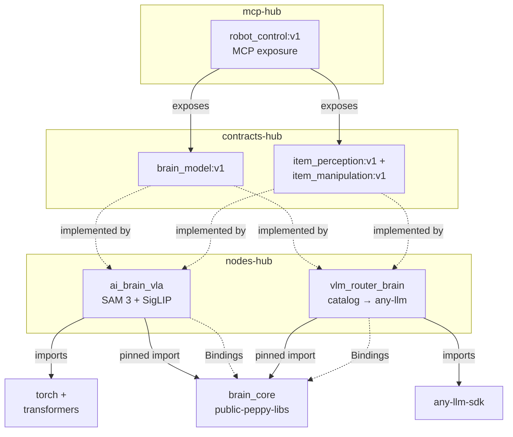
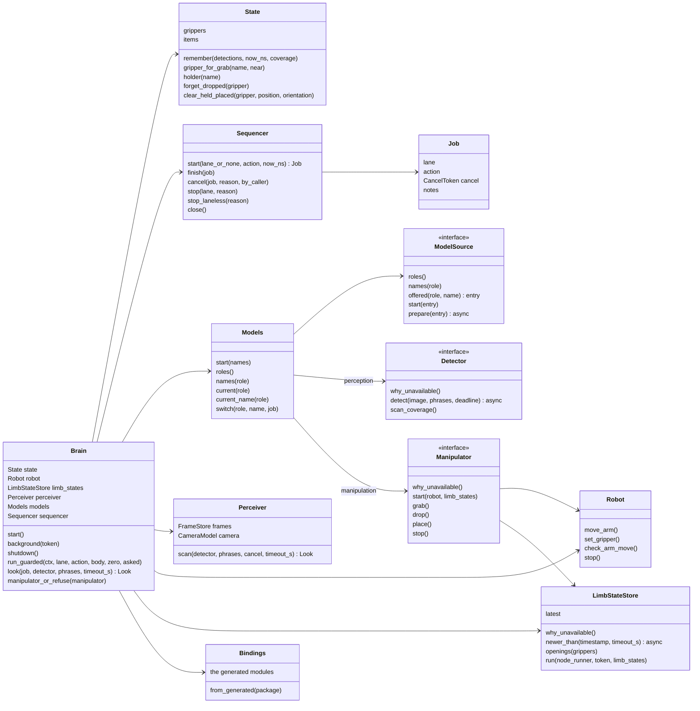
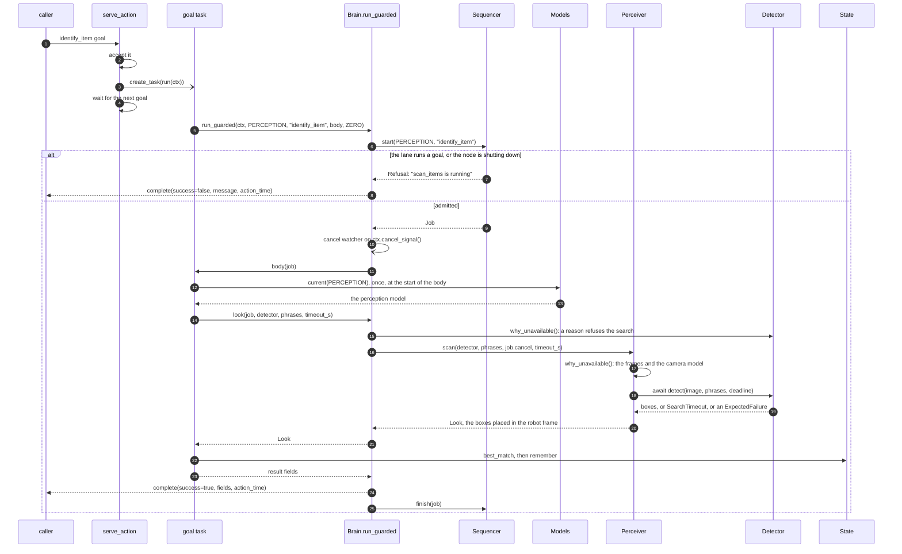
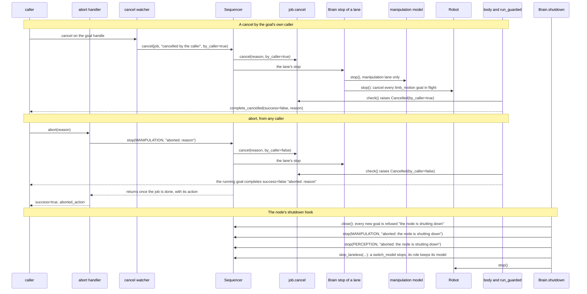

# brain_core

The code every brain node shares. A brain serves `item_perception:v1`,
`item_manipulation:v1` and `brain_model:v1` over a robot that `limb_motion:v1`
drives and `limb_state:v1` measures, and a camera that `rgbd_camera:v1` streams. brain_core holds the contract rules (item ids,
the gripper table, the lanes, the result rules), the robot proxy, the camera
frames and geometry, and the loop of each exposed member. A node brings its
generated peppygen modules and its backends, and calls `node.setup`.

Pure Python on numpy and Pillow. brain_core never imports peppygen: peppygen is
generated per node, so the node passes its modules in through `Bindings`.

## Using it

A node depends on brain_core by commit. Both brains pin it in
`[tool.uv.sources]`, the way `so101/backbone` pins its shared libraries:

```toml
[tool.uv.sources]
brain_core = { git = "https://github.com/Peppy-bot/public-peppy-libs", subdirectory = "brain_core", rev = "<commit>" }
```

uv fetches a git source with git, and the `peppybot/python-uv-base` image has
no git, so the node's `apptainer.def` installs it in `%post` before
`uv sync`, as nodes-hub's `ai_brain_vla/apptainer.def` does.

Its entry point builds `Bindings` from its peppygen package and hands them to
`brain_core.node.setup` with its `ModelSource`, the models the node can run
for each role. `Bindings.from_generated` finds each module where every
brain's peppygen puts it, so the node's manifest names its slots
`limb_motion`, `limb_state`, `camera`, `geometry` and `camera_mounts`, as both
brains do:

```python
import peppygen
from peppygen import NodeBuilder

from brain_core import node
from brain_core.bindings import Bindings

BINDINGS = Bindings.from_generated(peppygen)


async def setup(params, node_runner):
    return await node.setup(params, node_runner, BINDINGS, MyModels(params))


def main() -> None:
    node.configure_logging("my_brain")
    NodeBuilder().run(setup)
```

The parameters the core reads are `limbs`, `camera_name`, and the starting
model of each role, `perception_model` and `manipulation_model`.

## The parts

| Module | What it holds |
|---|---|
| `ports` | The plain data that crosses the seams (`Box`, `Detection`, `Item`, `Gripper`, `Grasp`, `Outcome`, `Pose`), the roles a model serves (`Role`, `parse_role`), `Refusal`, `ExpectedFailure`, `Cancelled`, `CancelToken`, `Deadline`, `SearchTimeout`, the ports a backend implements, `Detector` (an awaited `detect`, and `why_unavailable`), `Manipulator` and the `GraspProposer` a manipulator asks, and the port a node implements, `ModelSource` |
| `words` | The one rule for whether a description names a label |
| `limbs` | The `limbs` parameter parsed: each gripper with the arm that carries it |
| `state` | The grippers, the known items and their ids, and the rules that resolve a goal's names |
| `sequencer` | One sequence at a time per lane (a lane is a `Role`), lane-less jobs beside them, and the way to stop the ones that run |
| `robot` | The proxy to the backbone: one limb_motion goal per move, `check_arm_move`, which asks whether a move has a plan and moves nothing, and `stop`, which cancels every move in flight |
| `limb_state` | The robot's measured limbs: each limb_states message parsed into a `LimbSnapshot` (each arm's joints and grasp pose, each gripper's opening), the latest one kept, the wait for one captured after another, and the openings get_state reports |
| `models` | The model of each role, and the switch rule: a goal uses only its own role's model, and a switch never changes the model of a goal that runs |
| `brain` | The parts assembled, and `run_guarded`, where every goal is admitted, completed the way the contract asks and logged |
| `handlers` | One module per exposed member |
| `serve`, `waiting` | The loop of an exposed action or service, and the one way a part waits unless a stop comes first |
| `perception` | The `Perceiver` (frames in, world detections out), the frame store, the camera model and the geometry learners, `in_daemon_thread` for a detector whose model blocks, and `NoneDetector` |
| `manipulation` | `NoneManipulator`; `ScriptedManipulator`, a grab from above through a fixed sequence of moves; `CentreProposer`, its grasp from the item's position; `grasp`, the geometry: the orientations workspace_core tries, the pre-grasp and lifted points |
| `bindings`, `node` | The generated modules a node passes in, and the shared entry |

## Tests

```
uv sync --frozen && uv run --frozen pytest
```

The tests run every core rule against fakes of the generated modules
(`tests/fake_peppygen.py`): no peppygen, no router, no robot and no model.

## How it works

### Where it sits

Both brains are thin: each brings only its models, and brain_core holds the
shared work. A dotted arrow is a manifest relation or a hand-over at run time.



brain_core receives each node's `Bindings` and its `ModelSource`; the
catalog and any-llm stay inside the router, and torch inside ai_brain_vla.

### Structure



A node implements `ModelSource`, and its models implement `Detector` or
`Manipulator`. `NoneDetector` and `NoneManipulator` are the models of a role
with none; `ScriptedManipulator` is a manipulator any node can offer, built
on a `GraspProposer`.

### A goal, from its arrival to its result

`identify_item`; `scan_items` runs the same way, and the manipulation goals
run in the manipulation lane on the manipulation model.



A Refusal, an ExpectedFailure or a Cancelled raised in the body goes up to
`run_guarded`, which completes the goal with the message; `action_time` is the
elapsed time whatever the outcome.

### A scripted grab

`ScriptedManipulator.grab`, after the handler has resolved the item and the
gripper. Each step that fails ends the grab with the backbone's own words. A
step that fails once the descent was sent first retreats: the gripper opens
and the arm moves straight back up to the pre-grasp point. A goal that a stop
ended (`cancelled` on its result) retreats from nothing.

Every move names its bars, as the limb_motion contract has the caller do. An
arm move, the retreat's and a place's too, plans within 1 mm and 0.01 rad of
its pose and settles within `settle_position_m` (2 cm) and
`settle_orientation_rad` (0.15 rad), the settle the robots' endpoint gives for
the OpenArm v2, or fails `settle_timeout_s` (2 s) after
its planned end with the backbone's words, such as `still 8.0 mm / 0.02 rad
from the target, 2.0 s after the planned end`. A check asks with the same
plan bars. A gripper move waits up to `grip_settle_timeout_s` (2 s) for the
jaws to stand still.

```mermaid
sequenceDiagram
    participant H as grab_item handler
    participant SM as ScriptedManipulator
    participant P as GraspProposer
    participant R as Robot
    participant L as LimbStateStore
    H->>SM: grab(item, gripper, max_effort, cancel)
    SM->>P: propose(item)
    P-->>SM: Grasp: the point, the orientations to try
    loop each orientation, until one plans
        SM->>R: check_arm_move: pre-grasp, grasp, lifted points
    end
    Note over SM: none plans: "no plan reaches item 'x' with gripper 'g': <last refusal>"
    SM->>R: set_gripper(g, the item's width and 1.5 cm each side, else 1)
    SM->>R: move_arm(pre-grasp), move_arm(grasp point): each settles, or fails
    SM->>R: set_gripper(g, 0, max_effort)
    Note over SM: final_opening below hold_opening_min: "gripper 'g' closed on nothing"
    SM->>R: move_arm(lifted point)
    SM->>L: newer_than(the latest stamp at the lift's result, snapshot_wait_s)
    Note over SM: none: "no limb_states snapshot after the lift"<br/>opening below hold_opening_min: "item 'x' slipped while lifting"
    alt a step from the descent on failed, and no stop ended it
        SM->>R: set_gripper(g, 1), move_arm(pre-grasp)
        Note over SM: either fails: "<failure>; the retreat to the pre-grasp point failed: <why>"
        SM-->>H: Outcome(false, the failure)
    else every step went through
        SM-->>H: Outcome(true): the handler sets the held flag
    end
```

Before the descent the jaws open only as wide as the item and 1.5 cm on each
side (`approach_margin_m`), as a fraction of their 14.8 cm span
(`jaw_travel_m`, the OpenArm v2's in Waldo), so the fingers come down beside
the item and not on what stands next to it. The width is the one the look that
last saw the item measured: the box's left and right edges at the depth of its
seen point. An item of no known width, one addressed by pose or put down by
place_item, gets the jaws fully open.

Each grab logs one line: the orientation that planned, with the number and
the total time of the check_arm_move calls; how wide the jaws opened for the
item's width; where the descent's result put the
grasp point against the commanded one (`[dx, dy, dz] cm`), measured once the
arm settled; limb_state's grasp point at the close; the two openings it
judged; and the retreat.

A place carries the item to the pose through its pre-place point, opens,
and climbs back to the pre-place point. An arm that stops short on its way
down, at least 1 cm below the pre-place point and on the line down, has set the
item on what is under it: the place opens there, logs how far short it stopped,
and reports that point. A stop of the descent, or an arm stopped higher or off
the line down, fails the place with the jaws closed. A climb that fails is
logged and the place still succeeds, since the item is down and the jaws are
open.

`CentreProposer` lowers a seen item's position by `grasp_depth_m` and tries
the eight rolls of a grasp from above; an item whose position is a grasp point
(a grab by pose, or an item place_item put down) is grasped there unlowered,
in its own orientation alone when it has one. After every await the sequence
checks its cancel token, so a cancel, an abort or a shutdown ends it at the
next step.

### Cancel, abort and shutdown


