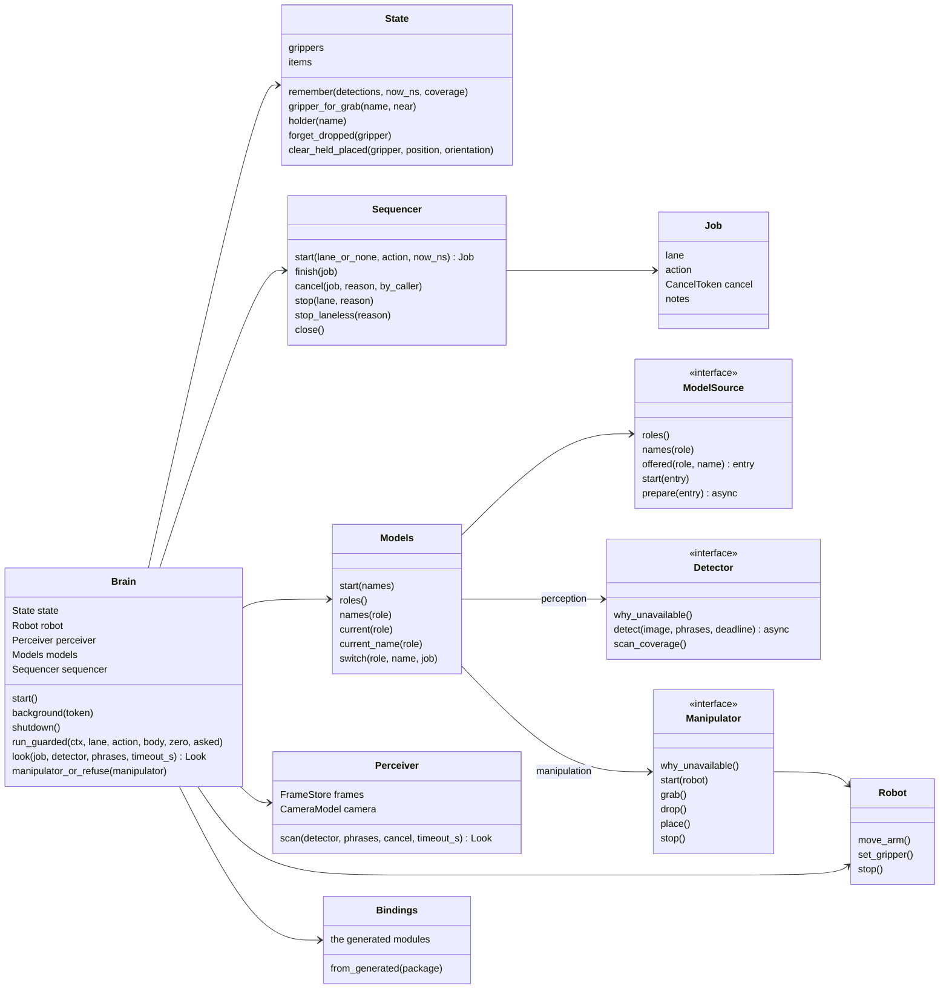
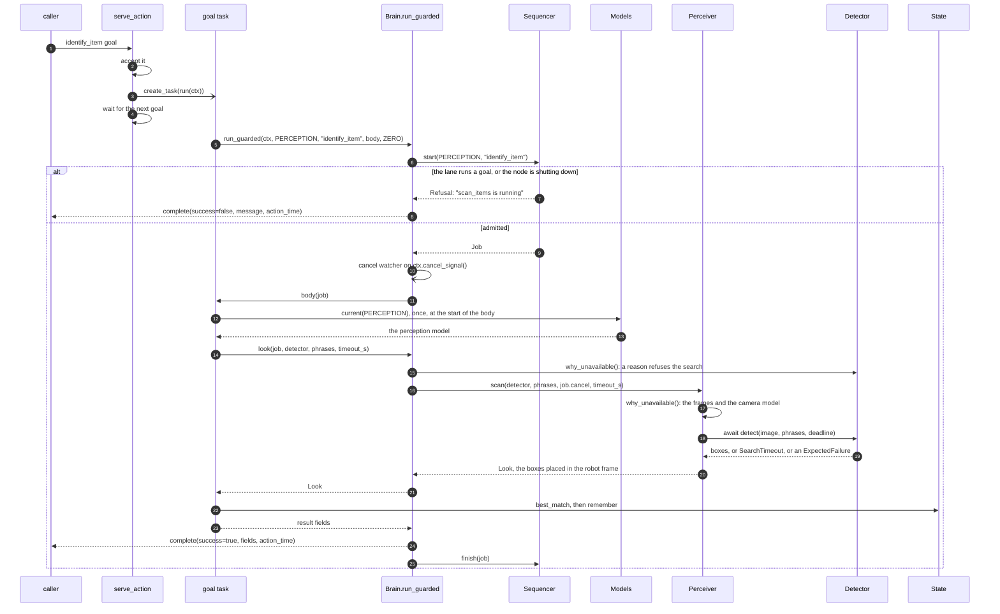
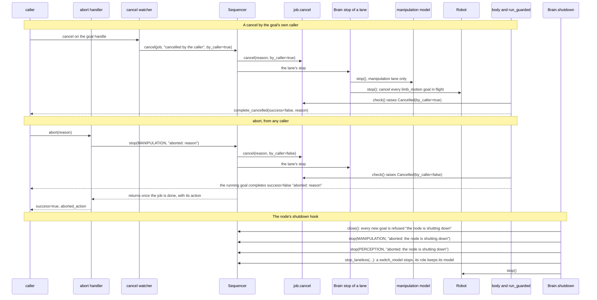

# brain_core

The code every brain node shares. A brain serves `item_perception:v1`,
`item_manipulation:v1` and `brain_model:v1` over a robot that `limb_motion:v1`
drives and a camera that `rgbd_camera:v1` streams. brain_core holds the contract rules (item ids,
the gripper table, the lanes, the result rules), the robot proxy, the camera
frames and geometry, and the loop of each exposed member. A node brings its
generated peppygen modules and its backends, and calls `node.setup`.

Pure Python on numpy and Pillow. brain_core never imports peppygen: peppygen is
generated per node, so the node passes its modules in through `Bindings`.

## Using it

A node depends on brain_core by commit:

```
brain_core @ git+https://github.com/Peppy-bot/public-peppy-libs.git@<commit>#subdirectory=brain_core
```

Its entry point builds `Bindings` from its peppygen package and hands them to
`brain_core.node.setup` with its `ModelSource`, the models the node can run
for each role. `Bindings.from_generated` finds each module where every
brain's peppygen puts it, so the node's manifest names its slots
`limb_motion`, `camera`, `geometry` and `camera_mounts`, as both brains do:

```python
import peppygen
from peppygen import NodeBuilder

from brain_core import node
from brain_core.bindings import Bindings

BINDINGS = Bindings.from_generated(peppygen)


async def setup(params, node_runner):
    return await node.setup(params, node_runner, BINDINGS, MyModels(params))


def main() -> None:
    node.configure_logging("my_brain")
    NodeBuilder().run(setup)
```

The parameters the core reads are `limbs`, `camera_name`, and the starting
model of each role, `perception_model` and `manipulation_model`.

## The parts

| Module | What it holds |
|---|---|
| `ports` | The plain data that crosses the seams (`Box`, `Detection`, `Item`, `Gripper`, `Outcome`, `Pose`), the roles a model serves (`Role`, `parse_role`), `Refusal`, `ExpectedFailure`, `Cancelled`, `CancelToken`, `Deadline`, `SearchTimeout`, the two ports a backend implements, `Detector` (an awaited `detect`, and `why_unavailable`) and `Manipulator`, and the port a node implements, `ModelSource` |
| `words` | The one rule for whether a description names a label |
| `limbs` | The `limbs` parameter parsed: each gripper with the arm that carries it |
| `state` | The grippers, the known items and their ids, and the rules that resolve a goal's names |
| `sequencer` | One sequence at a time per lane (a lane is a `Role`), lane-less jobs beside them, and the way to stop the ones that run |
| `robot` | The proxy to the backbone: one limb_motion goal per move, and `stop`, which cancels every move in flight |
| `models` | The model of each role, and the switch rule: a goal uses only its own role's model, and a switch never changes the model of a goal that runs |
| `brain` | The parts assembled, and `run_guarded`, where every goal is admitted, completed the way the contract asks and logged |
| `handlers` | One module per exposed member |
| `serve`, `waiting` | The loop of an exposed action or service, and the one way a part waits unless a stop comes first |
| `perception` | The `Perceiver` (frames in, world detections out), the frame store, the camera model and the geometry learners, `in_daemon_thread` for a detector whose model blocks, and `NoneDetector` |
| `manipulation` | `NoneManipulator` |
| `bindings`, `node` | The generated modules a node passes in, and the shared entry |

## Tests

```
uv sync --frozen && uv run --frozen pytest
```

The tests run every core rule against fakes of the generated modules
(`tests/fake_peppygen.py`): no peppygen, no router, no robot and no model.

## How it works

### Structure



A node implements `ModelSource`, and its models implement `Detector` or
`Manipulator`. `NoneDetector` and `NoneManipulator` are the models of a role
with none.

### A goal, from its arrival to its result

`identify_item`; `scan_items` runs the same way, and the manipulation goals
run in the manipulation lane on the manipulation model.



A Refusal, an ExpectedFailure or a Cancelled raised in the body goes up to
`run_guarded`, which completes the goal with the message; `action_time` is the
elapsed time whatever the outcome.

### Cancel, abort and shutdown


